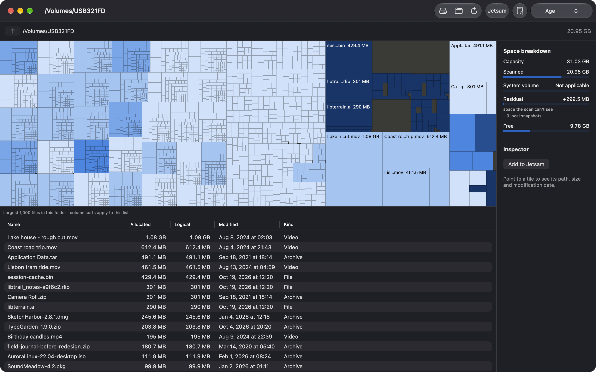
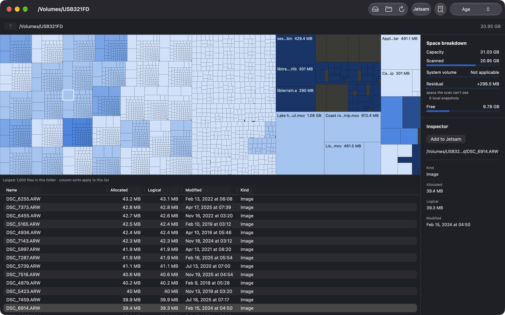
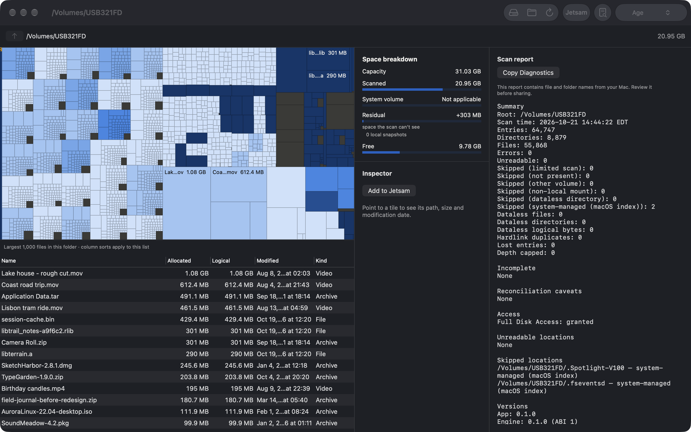
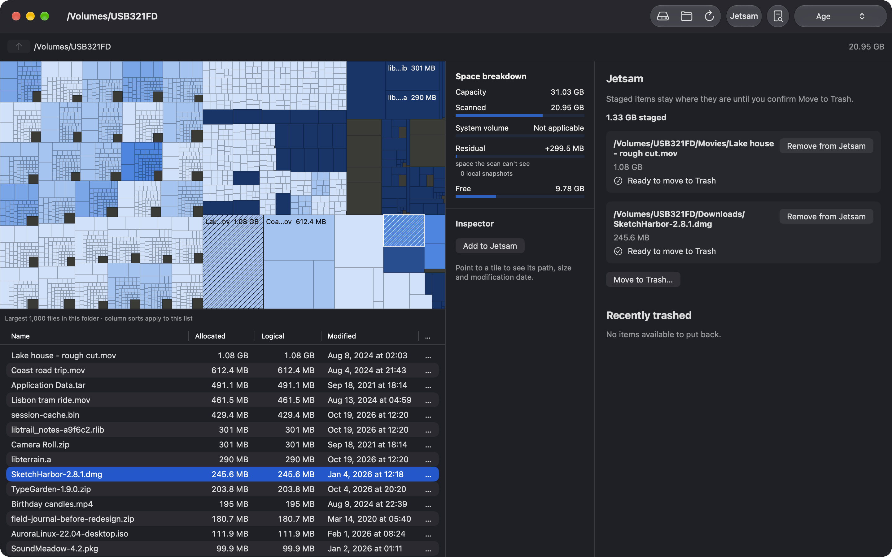

# Tesserae

Tesserae is a GPL-3 disk-space visualizer for macOS 13 Ventura and later,
with a Rust scan engine and a SwiftUI/Metal treemap. Explore what uses space,
inspect files, and reclaim space with reviewed Trash, Compress and Archive actions.



## Install

**Download:** get `Tesserae-X.Y.Z.dmg` from the
[latest release](https://github.com/sdelavega/tesserae/releases/latest), open
it, and drag **Tesserae** to **Applications**. Every release is signed with a
Developer ID, notarized by Apple and stapled, so it opens without warnings, even
offline.

**Homebrew:**

```sh
brew install --cask sdelavega/tap/tesserae
```

Requires macOS 13 Ventura or later, on Apple Silicon or Intel.

## Updates

Tesserae updates itself with [Sparkle](https://sparkle-project.org). Once a
day it fetches a small update feed from GitHub Pages. That request carries the
app's version and your macOS version, and nothing else. Each update is signed
with the project's EdDSA key, and Tesserae verifies that signature before
installing anything.

- **Check now:** **Tesserae → Check for Updates…**
- **Turn automatic checks off:** **Tesserae → Settings…** (⌘,), then clear
  **Check for updates automatically**.

Homebrew installs update through Sparkle too, so `brew upgrade` isn't needed.

## Using Tesserae

### Choose a location

On the start screen, choose a volume under **This Mac**, **Other disks** or
**Network**, then click **Scan** or double-click its row. You can also use
**Choose a Folder…** (⌘O). Network volumes scan more slowly.

Use **File → Scan Another Location…** (⌘⇧N), or the leftmost toolbar button,
to return to this list. Your current scan stays open until you start another.
⌘⇧O scans your startup disk's Data volume, where your files and apps live;
the read-only system volume appears in the space breakdown. Progress counts
files as they are scanned. For a complete picture, grant Full Disk Access
(see below).

### Explore the map

Each tile is a file or folder, sized by its space on disk. Click to zoom one
folder level in. Use the breadcrumb or ⌘↑ to go back up; arrow keys move
between sibling tiles, and Return enters a folder.

**Folder** (⌘1), the default colour mode, gives each top-level folder a hue,
with depth shading inside it. **Age** (⌘2) colours by modification date;
**Type focus** (⌘3) highlights up to three file types.

Large folders have name-and-size strips. **View → Show Folder Names** turns
these on or off. Rest your pointer on a tile for half a second to see its
path from the scan root and its size. The **Inspector** shows the same path
and file details; **Copy Path** copies the absolute path.

The **Folders** tree beside the map shows folders and files, largest first.
Expand a folder to see its children, sort by a column, or double-click a
folder to enter it. Selection follows between the tree and map. Switch to
**Largest Files** for the top 1,000 files under the current view; column sorts
reorder that list.

### Check the scan

For a whole-volume scan, the **space breakdown** compares what the scan found
with what the volume reports: the system volume, free space and local
snapshots. A positive gap is space the scan couldn't see; a negative gap
means shared blocks were counted twice.

**Scan report** lists unreadable and skipped locations, cloud-only files and
anything that made the scan partial. **Copy Diagnostics** copies it to your
clipboard for a bug report.

### Reclaim space

Select items and choose **Add to Reclaim Space** (⌘⌫). Staging leaves your
files where they are; Tesserae never permanently deletes them. Open
**Reclaim Space**, choose an action for each item,
then review and confirm. Protected locations are refused with a reason;
warnings need your acknowledgement one by one. Unavailable actions stay
visible but disabled, with an explanation.

- **Move to Trash** sends items to the Trash. Space is freed when you empty
  it in Finder. **Open Trash** in the results takes you there. **Put Back**
  restores items from the results or **Recently trashed**; on volumes such as
  exFAT that can't safely rename without overwriting, use Finder's Put Back.
- **Compress** keeps files in place and readable by your apps, using
  transparent compression on local, writable APFS or Mac OS Extended (HFS+)
  disks. Ineligible files are skipped with a reason. The review shows an
  estimated saving; the result reports the measured change. Cancel takes
  effect between batches.
- **Archive** creates one archive beside each item, verifies it, then moves
  the original to the Trash. You reclaim space after emptying the Trash.
  Rescan to see the archive in the map. If the disk has no usable Trash,
  both the archive and the original are kept, and the result tells you so.

### Choose an archive format

The format picker remembers your choice. **Advanced** reveals the extra
formats.

| Format | APFS / HFS+ | Other disks | How you open it |
|---|---|---|---|
| Apple Archive, fast (.aar, LZFSE) | Default | Advanced | Finder on a Mac; fast, about ZIP's size. |
| ZIP | Available | Default | Finder, Windows and other ZIP readers. |
| tar.xz | Available | Available | Finder (Archive Utility); smaller, slower to create. |
| Apple Archive, smallest (.aar, LZMA) | Advanced | Advanced | Finder on a Mac; smaller than LZFSE. |
| tar.zst | Advanced | Advanced | Install zstd, or use an app such as Keka; Finder and macOS's tar can't open it unaided. |

Before originals go to the Trash, the archive must match their file contents
(SHA-256), sizes, entry types, directory entries and symlink targets. Missing,
extra or duplicate content fails verification. Tesserae also rechecks the
originals' identities and directory membership for changes. Extended attribute
contents aren't byte-verified. If creation or verification fails, the originals
stay and the failed archive goes to the Trash.

On exFAT/FAT disks, macOS uses companion `._` files for Mac metadata. Tesserae
recognises hidden, paired AppleDouble sidecars and treats them as metadata.
Orphan `._` files and other `._` content need Apple Archive; ZIP and tar are
disabled when they can't keep them. On APFS/HFS+, every real `._` file is
content and likewise needs Apple Archive. If you select a recognised sidecar
itself, archive its sibling instead.

### Decompress

In **Reclaim Space → Recently compressed**, choose **Decompress…** and review
the current warnings. This restores ordinary storage for files Tesserae
compressed in that run, provided their identities still match. It needs
additional free space and doesn't act on files compressed by other apps.






## Feedback

Found a bug, a confusing number, or something Tesserae should show? Please
[open an issue](https://github.com/sdelavega/tesserae/issues/new). For scan
problems, attach the output of **Scan report → Copy Diagnostics**, after
checking it for file names you'd rather not share. Ideas and questions are
welcome in issues too.

## Full Disk Access

To include protected folders in a scan, enable Tesserae in **System Settings →
Privacy & Security → Full Disk Access**, then relaunch the app. macOS requires
this permission to read protected locations such as Mail and other apps' data.
Without it, Tesserae still works in limited mode and reports unreadable areas;
it cannot measure space it cannot read. Full Disk Access is granted by you,
and is never supplied by an entitlement.

No telemetry. The only network traffic is the update check.

## Support

The Apple Developer Program costs $99/yr. Donations cover the Apple Developer
account that lets this ship notarized. Support is optional via
[GitHub Sponsors](https://github.com/sponsors/sdelavega), also available from
**Help → Support Tesserae…**. There are no donation prompts at launch.

## Build

Install Xcode with the macOS SDK and Metal toolchain, Rust via rustup, `just`,
and `cargo-deny`. The toolchains are pinned by `rust-toolchain.toml` and
`scripts/nightly-toolchain`. Clone the repository to, for example,
`~/src/tesserae`, then:

```sh
cd ~/src/tesserae
export PATH=~/.cargo/bin:"$PATH"
export RUSTUP_TOOLCHAIN=stable
rustup target add aarch64-apple-darwin x86_64-apple-darwin
just ffi
just app-build
just gate
```

The app is built at `apple/build/DerivedData/Build/Products/Release/Tesserae.app`.
Xcode links the prebuilt Rust archive; run `just ffi` after changing Rust code.
Local Release builds work without a Developer ID using ad-hoc signing (the
`app-build` recipe disables signing for CI).

For Developer ID releases, copy `apple/Release.local.xcconfig.example` to
`apple/Release.local.xcconfig` and replace its team, certificate SHA-1 and
notary profile placeholders. The local file is git-ignored. Keep certificates,
passwords and private keys out of the repository. Use `just release X.Y.Z`
to build and verify, or `just release X.Y.Z --publish` to review and confirm publication. See
[Releasing Tesserae](docs/releasing.md) for local setup, CI credentials and
verification requirements.

`MARKETING_VERSION` is the version source. `scripts/bundle-version.sh x.y.z`
derives the integer build number as `major*10000 + minor*100 + patch`; each
component must be less than 100. The committed build number must match it;
the release pipeline must pass the derived value as `CURRENT_PROJECT_VERSION`.

## License

GNU General Public License, version 3 or later. See [LICENSE](LICENSE) for the
full text, also bundled in the app and linked from **About Tesserae → Licenses**.

Transparent compression uses the bundled [applesauce](https://github.com/Dr-Emann/applesauce)
helper (GPL-3.0-or-later), pinned to
[applesauce-cli-v0.5.30](https://github.com/Dr-Emann/applesauce/releases/tag/applesauce-cli-v0.5.30).
Its licence and dependency notices are bundled with Tesserae's licences.
